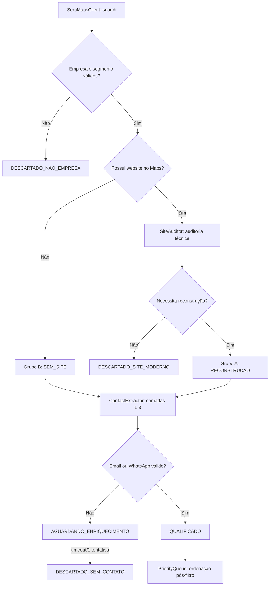

# Radar AI — Arquitetura v2: Funil Eliminatório de Prospecção

> Reescrita arquitetural do motor de qualificação de leads (`app/Radar.php`, `src/Scrapers/ProspectScraper.php`, `src/Services/OutreachService.php`), corrigindo a inversão conceitual identificada no diagnóstico: o sistema hoje recompensa presença digital moderna em vez de identificar necessidade comercial real.

---

## 0. Princípio Arquitetural Central

Todo o redesenho decorre de uma única regra, que substitui o score somatório atual:

```
QUALIFICADO =
    empresa_compatível
    E (site_ausente OU necessidade_reconstrução_comprovada)
    E (email_válido OU whatsapp_válido)
```

Nenhuma porta é compensável por outra. O score deixa de ser **critério de entrada** na fila e passa a ser **critério de ordenação** dentro da fila, calculado apenas depois que o prospect já passou pelas três portas.

Isso implica remover o modelo atual (`RadarRunner::run()` → soma ponderada → threshold único `radar.minimum_score`) e substituí-lo por um pipeline de estágios com curto-circuito.

---

## 1. Visão Geral do Pipeline



Cada retângulo do diagrama corresponde a uma classe ou responsabilidade isolada — não a uma função dentro de `RadarRunner`, que hoje concentra tudo. O objetivo é que cada porta seja testável isoladamente e substituível sem tocar nas demais.

---

## 2. Reestruturação de Módulos (`app/` e `src/`)

### 2.1 Estado atual (problema)

```
app/Radar.php
 ├── SerpMapsClient        (busca)
 └── RadarRunner::run()    (busca + auditoria + IA + score + persistência + fila, tudo acoplado)
```

`RadarRunner::run()` mistura oito responsabilidades em um único método. É o ponto exato onde `old_signals`, `fit_score` e contato se misturam indevidamente.

### 2.2 Estrutura proposta

```
app/
 ├── Radar.php                    # mantém SerpMapsClient; RadarRunner vira apenas orquestrador fino
 ├── DatabaseMigrationService.php
 ├── Intelligence.php             # revisado: prompts + contrato de resposta estruturado
 └── SettingsVault.php

src/
 ├── Pipeline/
 │   ├── RadarPipeline.php        # substitui a lógica interna de RadarRunner::run()
 │   ├── Stage1_BusinessGate.php  # empresa real + segmento (curto-circuito)
 │   ├── Stage2_SiteState.php     # ausente | moderno | aceitável | antigo | quebrado | abandonado
 │   ├── Stage3_RebuildGate.php   # necessidade eliminatória (não soma, decide)
 │   ├── Stage4_ContactGate.php   # email OU whatsapp validado (curto-circuito)
 │   └── ProspectDecision.php     # DTO imutável: decision, evidence[], group (A|B)
 │
 ├── Scrapers/
 │   ├── ProspectScraper.php      # camada 1 (mantido, com correções abaixo)
 │   └── JsBundleExtractor.php    # NOVO — camada 2 (SPAs)
 │
 ├── Audit/
 │   ├── SiteAuditor.php          # NOVO — substitui a checagem superficial embutida hoje
 │   └── OldSignalsPolicy.php     # NOVO — regras explícitas de envelhecimento (ver seção 4)
 │
 ├── Services/
 │   ├── OutreachService.php      # revisado: só dispara com contactability confirmada
 │   ├── SmtpDiagnosticService.php # NOVO (ver seção 5)
 │   └── PriorityScoringService.php # NOVO — substitui o score somatório antigo
 │
 └── Utils/
     └── PhoneValidator.php       # mantido
```

**Por que separar em estágios com classe própria:** hoje uma alteração na regra de WhatsApp exige editar o mesmo método que calcula `fit_score` e grava no banco. Com estágios isolados, cada `StageN` recebe um DTO de entrada e devolve um DTO de saída com veredito + evidências — nunca aborta o pipeline sem justificar o motivo, o que resolve diretamente o problema "a IA declara site velho sem apontar evidência".

---

## 3. Contrato de Dados: `ProspectDecision`

Substitui os campos soltos (`fit_score`, `commercial_score`, `old_signals[]`) por um objeto único e rastreável, gravado em `site_ai_analyses.analysis_json`:

```php
final class ProspectDecision {
    public bool $is_real_business;
    public bool $business_fit;
    public string $site_state;        // ausente|moderno|aceitavel|antigo|quebrado|abandonado
    public int $rebuild_need;         // 0-100, eliminatório abaixo do limiar (não somado)
    public bool $contactability;      // true apenas com email OU whatsapp validados
    public array $evidence;           // ["copyright expirado ha 4 anos", "12 erros JS", ...]
    public string $group;             // A_RECONSTRUCAO | B_SEM_SITE
    public string $decision;          // QUALIFICADO | AGUARDANDO_ENRIQUECIMENTO | DESCARTADO_*
    public int $priority_score;       // calculado SÓ depois de QUALIFICADO
}
```

`Intelligence.php` é reescrito para retornar exatamente esses campos — nunca um score único pré-misturado — e `PriorityScoringService` é o único lugar autorizado a transformar isso em número de ordenação.

---

## 4. `SiteAuditor` + `OldSignalsPolicy` — Correção dos Detectores

Tabela de migração de regras (o que sai de `old_signals` e para onde vai):

| Sinal | Hoje | v2 |
|---|---|---|
| `wa.me` / `api.whatsapp.com` | `old_signals += 1` | Removido daqui → alimenta **apenas** `Stage4_ContactGate.contactability` |
| CMS = WordPress/Wix/Joomla | `old_signals += 1` (automático) | `OldSignalsPolicy` verifica **versão**, tema, recursos depreciados — não a plataforma em si |
| Status HTTP + viewport + HTTPS | único critério técnico | mantidos, mas viram 3 de ~12 sinais em `SiteAuditor` |

Novos sinais que `SiteAuditor` passa a coletar (todos exigem evidência textual/estrutural, não inferência):

- assets 404 (imagens/CSS/JS quebrados)
- erros de console JS capturados via headless (camada opcional)
- layout de largura fixa / não responsivo
- elementos HTML obsoletos (`<marquee>`, `<font>`, tabelas de layout)
- texto "em construção" / página vazia
- certificado TLS inválido ou expirado
- copyright com ano ≥ 3 anos no passado
- indício de última atualização (sitemap, `last-modified` de assets)

`OldSignalsPolicy::classify()` devolve `site_state` + a lista de `evidence` que alimenta diretamente `ProspectDecision.evidence`, fechando o requisito "IA não pode declarar site velho sem apontar evidência do analisador".

---

## 5. `ContactExtractor` em Camadas (correção do caso Ricardo do Gás — Angular)

`ProspectScraper::scrape()` hoje só cobre a Camada 1. A correção adiciona um extrator dedicado a JS, mantendo o scraper atual como primeira etapa de uma cadeia (Chain of Responsibility):

```
ContactExtractorChain
 ├── Layer1_StaticHtml        (ProspectScraper atual: <a>, mailto:, tel:, wa.me no HTML)
 ├── Layer2_JsBundleScan      (NOVO: JsBundleExtractor)
 │     limites: só mesmo domínio | máx 3 bundles | máx 1.5MB/arquivo | timeout curto
 │     regex restrita a e-mail e wa.me/api.whatsapp.com/send?phone=
 │     NUNCA converte número solto de JS em telefone (proteção explícita contra IDs/timestamps/hashes)
 └── Layer3_Headless          (opcional, só para prospects já classificados como Grupo A/B sem contato)
```

Cada camada só executa se a anterior não encontrar `email válido OU whatsapp válido` — evitando custo de headless browser em massa.

---

## 6. `SmtpDiagnosticService` — Correção do Motor de Envio

Problema real identificado nos logs: o cliente SMTP ignora `smtp.encryption` e sempre faz `TCP → STARTTLS → AUTH LOGIN`, mesmo quando a porta exige SSL implícito.

### 6.1 Lógica condicional por porta

```php
match ($config->port) {
    465 => $this->connectImplicitSsl($config),   // ssl:// direto, sem STARTTLS
    587 => $this->connectStartTls($config),      // tcp:// + STARTTLS
    25  => $this->connectPlain($config),         // sem criptografia (não recomendado, mas suportado)
};
```

### 6.2 Painel de diagnóstico sequencial (para com o primeiro passo que falhar)

1. Resolução DNS (registro A/AAAA)
2. Abertura de socket TCP/TLS
3. Leitura do banner (`220`)
4. Negociação TLS + validação de certificado
5. Autenticação (base64) → espera `235 Authenticated`
6. `MAIL FROM` de teste

Cada etapa é um método público independente em `SmtpDiagnosticService`, retornando `{step, status, raw_response}` — permitindo à UI mostrar exatamente onde a cadeia quebrou, em vez do erro genérico atual (`535 Incorrect authentication data` sem contexto de qual etapa).

### 6.3 Regra de credenciais

Validação de formato antes de tentar conectar: usuário deve casar com `^[^@]+@dominio_configurado$`, evitando o erro silencioso de usar login do cPanel em vez do e-mail completo.

---

## 7. Estados e Fila (`radar_runs`, `prospects`, `site_ai_analyses`)

### 7.1 Novo enum de status em `prospects.status`

| Estado | Critério de entrada | Critério de saída |
|---|---|---|
| `QUALIFICADO` | Passou pelas 3 portas | Entra na fila priorizada |
| `AGUARDANDO_ENRIQUECIMENTO` | Empresa+necessidade OK, contato pendente | 1 tentativa de enriquecimento OU timeout configurável |
| `DESCARTADO_SEM_CONTATO` | Enriquecimento esgotado sem email/whatsapp | Terminal |
| `DESCARTADO_SITE_MODERNO` | `rebuild_need` abaixo do limiar | Terminal |
| `DESCARTADO_NAO_EMPRESA` | Falhou Stage1 (notícia/diretório/blog) | Terminal |

### 7.2 Fila = `PriorityScoringService`

Só recebe prospects com `decision = QUALIFICADO`. O score aqui pondera exclusivamente **oportunidade dentro dos já elegíveis** (ex.: severidade da necessidade, facilidade de contato, ticket estimado por segmento) — nunca decide elegibilidade.

### 7.3 `queue_worker.php` / `OutreachService.php`

Adicionar trava explícita antes de qualquer disparo:

```php
if (!$prospect->hasValidatedEmail() && !$prospect->hasValidatedWhatsapp()) {
    throw new OutreachBlockedException('Contato não validado — bloqueado por política.');
}
```

Isso fecha a brecha atual em que formulário/redes sociais/termos comerciais falsamente satisfazem "componente de contato > 0".

---

## 8. Grupos A/B como Cidadãos de Primeira Classe

Hoje, resultados do Maps sem `website` são simplesmente ignorados — a oportunidade "empresa sem site" nunca chega a existir no funil. `Stage2_SiteState` passa a tratar `site_ausente` como um estado legítimo (não um erro), roteando diretamente para o Grupo B sem passar por `SiteAuditor`.

| | Grupo A — Reestruturação | Grupo B — Criação |
|---|---|---|
| Gatilho | Site existe e reprovado em `Stage3_RebuildGate` | Campo `website` vazio no Maps, confirmado |
| Fonte de contato | Site + camadas do extrator | Maps/redes sociais (nunca o próprio diretório como alvo) |
| Telefone do Maps | Enriquecimento apenas | Enriquecimento apenas — **não** vira WhatsApp sem validação explícita |
| Proposta | Diagnóstico com evidências técnicas | Presença institucional inexistente |

---

## 9. Higienização e Segurança (pré-requisito de implantação)

Antes de qualquer deploy da v2:

1. **Consolidar** as 3 cópias aninhadas (`prospects/prospects/prospects/`) em uma raiz única — script de merge com diff, não cópia cega.
2. **Rotacionar** todas as credenciais expostas: `.env`, chave do `SettingsVault`, senha SMTP, chaves de API.
3. **Isolar** o dump SQL: tratá-lo como snapshot de auditoria, nunca executá-lo via `DatabaseMigrationService` como migration incremental.
4. **Expurgar** logs de produção, cache de testes e arquivos `bin/ingram_*` (pertencentes a outro projeto) do pacote do Radar.

---

## 10. Ordem de Execução Recomendada

```
1. Higienização do pacote + rotação de credenciais
2. RadarPipeline + Stage1..Stage4 (esqueleto com curto-circuito, sem IA ainda)
3. OldSignalsPolicy + SiteAuditor (corrige os falsos sinais)
4. ContactExtractorChain (Layer2 JsBundleScan resolve o caso Angular)
5. SmtpDiagnosticService (painel passo a passo + modos por porta)
6. Intelligence.php reescrito para o contrato ProspectDecision
7. PriorityScoringService substitui o score somatório
8. Trava de contato em OutreachService/queue_worker
9. Grupo B habilitado (prospects sem website deixam de ser descartados)
10. Migration de reclassificação da base existente para os novos estados
11. Reativação da fila automática — só após validar amostra manual do novo funil
```

---

## 11. Critérios de Aceite (para validar a reescrita)

- Nenhum prospect com `rebuild_need` abaixo do limiar chega a `QUALIFICADO`, independentemente do score de contato.
- Nenhum disparo automático ocorre sem `email` ou `whatsapp` validados — testável via `OutreachBlockedException`.
- `wa.me`/`api.whatsapp.com` nunca incrementa `old_signals` nos testes de regressão de `OldSignalsPolicy`.
- Site Angular de teste (padrão Ricardo do Gás) tem contato extraído via `Layer2_JsBundleScan` sem falso positivo de telefone solto.
- Painel SMTP identifica corretamente o passo de falha em conexões porta 465 e porta 587 simuladas.
- Todo `ProspectDecision.decision = DESCARTADO_SITE_MODERNO` possui pelo menos 1 item em `evidence`.
