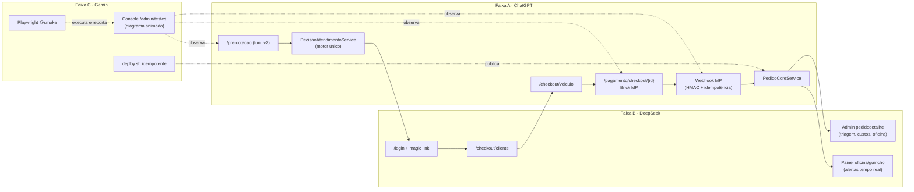

# Protocolo Multi-Agente — GuinchaFácil

**Objetivo:** ChatGPT, DeepSeek e Gemini trabalham em faixas (lanes) separadas, com contratos escritos, testes cruzados e checkpoints no Git. Assim nenhuma IA reinvestiga o projeto inteiro e nenhuma desfaz o trabalho da outra.
---

## 0. Segurança (faça antes de tudo)

Nesta conversa apareceram em texto puro: `MP_CLIENT_SECRET_PROD`, `MP_WEBHOOK_SECRET`, tokens `APP_USR-` completos e a senha `teste123` de contas em produção.

- **Rotacione** no painel do Mercado Pago: client secret, webhook secret e access tokens de produção.
- **Nunca** cole `.env` inteiro numa IA. Use `grep -E "^MP_" .env | sed 's/=.*/=***/'`.
- Desative ou apague `cliente1..3@teste.local` em produção quando terminar os testes.
- Todo prompt abaixo proíbe imprimir segredos.

---

## 1. Por que você cai no loop e as 6 regras que quebram ele

**Causa:** não existe uma "verdade" escrita no repositório. Cada IA reconstrói o contexto lendo tudo, acha "problemas" que já estavam resolvidos e mexe fora da sua área.

| # | Regra | Como se aplica |
| --- | --- | --- |
| R1 | **Uma faixa, um dono.** | Só o dono escreve nos arquivos da sua faixa (`docs/lanes.json`). |
| R2 | **Contrato antes de código.** | Mudou entrada/saída entre faixas? Edita `docs/CONTRATOS.md` primeiro, e você aprova. |
| R3 | **Checkpoint verde.** | Só se cria tag `ok-AAAAMMDD-N` com smoke test 100% verde. Rollback = `git reset --hard <tag>`. |
| R4 | **Orçamento de investigação.** | Máx. 5 arquivos e 5 comandos antes de propor correção. Falhou 2x no mesmo ponto? Escreve `docs/BLOCKERS.md` e para. |
| R5 | **Ninguém testa a própria faixa.** | Matriz de teste cruzado na seção 2. |
| R6 | **Diff mínimo.** | Sem "limpezas" fora da tarefa. Exclusão de arquivo só com sua autorização escrita. |

**Decisão D1 (antes de liberar os agentes):** o doc de análise aponta dois motores (Especialista e Oficina/Decisão). Recomendo declarar `DecisaoAtendimentoService` como motor único. Os serviços legados ficam **congelados, sem apagar**, até o admin migrar. Escreva isso em `docs/DECISOES.md`.  


---

## 2. Divisão das faixas

| Faixa | Dono | Por quê | Quem testa |
| --- | --- | --- | --- |
| **A. Motor + Checkout + Pagamento** (dinheiro e regra de negócio) | **ChatGPT** | Mais rigor em lógica e refatoração sensível | **Gemini** (E2E + contrato) |
| **B. Cadastro/Auth + Painéis (cliente, oficina, guincho, admin detalhe)** | **DeepSeek** | Volume de código de tela bem especificado e barato | **ChatGPT** (testes PHP de contrato) |
| **C. QA + Console de testes no admin + Deploy/infra** | **Gemini** | Contexto grande, bom para varrer o repo e ler logs | **DeepSeek** (roda o deploy 2x e faz "mutação": quebra algo de propósito e confere se o teste falha) |

### Arquivos e rotas por faixa

**A — ChatGPT**

- Rotas: `/pre-cotacao*`, `/checkout/veiculo`, `/checkout/pagar`, `/pagamento/checkout/{id}`, `/pagamento/mercadopago/pagar`, `/webhook/mercadopago`
- Escreve: `src/Controllers/{PreCotacaoApiController,CheckoutController,PagamentoController,WebhookController}.php`, `src/Services/{DecisaoAtendimentoService,PedidoCoreService,PricingService,Payment/*,PagamentoAprovacaoService}.php`, `src/Models/{Pedido,Pagamento,Veiculo}.php`, `src/Views/public/checkout-veiculo.php`, `src/Views/pagamento/*`, `public/assets/js/{public-pre-cotacao-flow,checkout-veiculo}.js`

**B — DeepSeek**

- Rotas: `/login`, `/auth/magic/{token}`, `/checkout/cliente`, `/cliente/*`, `/oficina/*`, `/guincho/*`, `/admin/pedidos`, `/admin/pedido/{id}`
- Escreve: `src/Controllers/{AuthController,OficinaController}.php`, `src/Services/Auth/MagicLinkService.php`, `src/Views/{auth,cliente,oficina,guincho}/*`, `src/Views/public/checkout-cliente.php`, `src/Views/admin/{pedidos,pedidodetalhe}.php`, `src/Views/admin/partials/_pedido_oficina_detalhe.php`

**C — Gemini**

- Rotas: `/admin/testes*`
- Escreve: `tests/**`, `playwright.config.js`, `tools/{smoke,lane_guard,deploy}.*`, `src/Controllers/Admin/TestesController.php`, `src/Views/admin/testes/*`, `install/migration_testes_v1.sql`, `.htaccess`

**Arquivos compartilhados (só você edita ou aprova):** `index.php` (rotas), `config.php`, `docs/CONTRATOS.md`, `docs/lanes.json`. Cada agente pede a rota nova num bloco `ROTA_PEDIDA:` e você cola no `index.php`. Isso evita conflitos no arquivo que já teve 24 duplicatas.

---

## 3. Diagrama de funcionamento



**Fluxo de trabalho diário**

```
XAMPP → branch lane/<faixa> → tools/lane_guard.ps1 → tools/smoke.ps1 (verde?)
      → commit → push → você revisa → merge main → tag ok-*
      → cPanel: bash tools/deploy.sh → smoke remoto → (falhou? git reset --hard <última tag ok>)
```

---

## 4. Idempotência: o que cada coisa deve garantir

| Item | Regra |
| --- | --- |
| Migrations | `INFORMATION_SCHEMA` + SQL dinâmico. Rodar 2x não altera nada. |
| Seeds (marcas/modelos) | `INSERT ... ON DUPLICATE KEY UPDATE` com chave única (marca, modelo). |
| Pagamento | `X-Idempotency-Key = "ped{id}-t{tentativa}"`. Reenviar o mesmo POST não cobra duas vezes. |
| Webhook | Índice único `(provedor, event_id)` em `logs_webhook`. Evento repetido retorna 200 sem reprocessar. |
| Criar pedido | Um pedido por `triage_session_id`. Duplo clique não duplica. |
| Dados de teste | Prefixo `E2E_`/`@teste.local`. Script de limpeza seguro para rodar N vezes. |
| deploy.sh | Pode rodar 2x seguidas: mesmo resultado, sem erro. |

`tools/deploy.sh` (Gemini implementa; esqueleto):

```bash
#!/usr/bin/env bash
set -euo pipefail
cd ~/public_html
git fetch origin && git reset --hard origin/main
for f in install/migration_*.sql; do php tools/run_migration.php "$f"; done   # idempotente
touch ~/.lsphp_restart.txt                                                      # limpa opcache
for u in /login /pre-cotacao /cliente/dashboard; do
  code=$(curl -s -o /dev/null -w "%{http_code}" "https://guinchafacil.com.br$u")
  echo "$u -> $code"; [[ "$code" =~ ^(200|302)$ ]] || { echo "FALHOU"; exit 1; }
done
echo "DEPLOY OK $(git rev-parse --short HEAD)"
```

`docs/lanes.json` + `tools/lane_guard.ps1` (falha o commit se tocar arquivo de outra faixa):

```powershell
param([Parameter(Mandatory)][string]$Lane)
$lanes = Get-Content docs/lanes.json -Raw | ConvertFrom-Json
$allowed = $lanes.$Lane
$changed = git diff --name-only origin/main...HEAD
$bad = $changed | Where-Object { $f=$_; -not ($allowed | Where-Object { $f -like $_ }) }
if ($bad) { Write-Host "FORA DA FAIXA ${Lane}:" -ForegroundColor Red; $bad; exit 1 }
Write-Host "lane_guard OK" -ForegroundColor Green
```

---

## 5. Console de testes no admin com diagrama animado (`/admin/testes`)

**Como funciona**

1. Cada cenário é um JSON em `tests/scenarios/*.json`: lista de passos com `key`, `node` (nó do diagrama), `probe` (o que verificar).
2. O runner PHP (`TestesController::executar`) roda passo a passo e grava em `test_runs` e `test_run_steps`: `run_id, step_key, node, status(pending|running|ok|fail), started_at, duration_ms, detail`.
3. A tela faz polling em `GET /admin/testes/run/{id}/events?after=N` (1s). Cada evento acende o nó do SVG: **cinza → azul pulsante (running) → verde (ok) / vermelho (fail)**. A aresta correspondente anima com `stroke-dashoffset` e o detalhe do passo aparece no painel lateral.
4. O Playwright roda na sua máquina (cPanel não roda browser) e envia resultados para `POST /admin/testes/ingest` com token. O diagrama anima do mesmo jeito.

**Cenários mínimos**

| Cenário | Nós animados |
| --- | --- |
| `fluxo-1a` | pré-cotação → decisão → login → cliente → veículo → pagamento → webhook → pedido |
| `idempotencia-pagamento` | mesmo POST 2x → 1 cobrança |
| `idempotencia-webhook` | mesmo evento 2x → 1 processamento |
| `admin-enxerga-oficina` | pedido da oficina → `pedidodetalhe` mostra `oficina_nome`, triagem e custos |
| `oficina-alertas` | pedido novo → alerta aparece no `oficina/dashboard` |
| `mp-config` | roda o equivalente a `diagnostico_mp_env --no-charge` |

**Guardas de segurança:** só admin, CSRF, bloqueia se `MP_ENV != sandbox`, só manipula dados `E2E_`, nunca exibe segredos.

---

## 6. Prompts (cole um em cada IA)

### 6.0 Preâmbulo comum (cole antes de qualquer prompt)

```
Você é um agente de implementação do projeto GuinchaFácil (PHP 8, MVC próprio, MySQL/MariaDB, XAMPP local, deploy em cPanel com LiteSpeed). O dono é um humano que revisa e faz o merge.

REGRAS INEGOCIÁVEIS
1. Leia SOMENTE: docs/ARQUITETURA.md, docs/CONTRATOS.md, docs/DECISOES.md, docs/lanes/<SUA_FAIXA>.md e os arquivos listados na sua faixa. Não explore o resto do repositório.
2. Escreva SOMENTE nos arquivos da sua faixa (docs/lanes.json). Precisa de rota nova ou mudança em arquivo de outra faixa? Emita um bloco "ROTA_PEDIDA:" ou "CONTRATO_PEDIDO:" e PARE essa parte.
3. Orçamento de investigação: máx. 5 arquivos e 5 comandos antes de propor a correção. Falhou 2x no mesmo ponto: registre em docs/BLOCKERS.md (sintoma, o que tentou, hipótese) e pare.
4. Nunca invente nomes de arquivo, método, coluna ou rota. Se não viu no código, diga "não verificado" e peça o trecho.
5. Nunca exiba segredos (.env, tokens, senhas). Mascare com ***.
6. Tudo idempotente: migrations com INFORMATION_SCHEMA, seeds com ON DUPLICATE KEY, scripts que podem rodar N vezes.
7. Diff mínimo. Não refatore, renomeie nem apague fora da tarefa. Arquivos UTF-8 sem BOM, com `php -l` limpo.
8. Formato de entrega: (a) lista de arquivos CRIAR/ALTERAR, (b) o código completo de cada um (comandos PowerShell para o XAMPP do Windows), (c) o comando exato para testar, (d) a saída esperada, (e) como reverter.
9. Você NÃO escreve os testes da sua própria faixa. Descreva os critérios de aceite; o outro agente testa.
10. Ao terminar: atualize docs/lanes/<SUA_FAIXA>.md (estado, contratos, pendências) e pare.  
11. NOTA IMPORTANTE: 
Toda execucao de criacao e alteracao de arquivo precisa ser feita em powershell com o cuidado para nao prejudicar o formato utf-8, analise syntatica e rollback em caso de erro
```

### 6.1 ChatGPT — Faixa A (Motor + Checkout + Pagamento)

```
[cole o preâmbulo 6.0]
SUA FAIXA: A (Motor + Checkout + Pagamento). Arquivos permitidos: os listados em "Faixa A" do protocolo.

MISSÃO
1. Consolidar DecisaoAtendimentoService como motor único (decisão D1). Faça PricingService delegar aos cálculos de TarifaService/EspecialistaPricingService (ou o inverso, você decide e documenta em DECISOES.md). Sem apagar legado. Saída: um único ponto de cálculo de preço, com strict_types.
2. Garantir que Pedido grave os campos do motor novo para o admin consumir: oficina_id/oficina_nome, triagem, custo_assistencia, custo_reboque, recomendacao, origem_funil ("oficina"|"especialista"). Publique isso em docs/CONTRATOS.md como "Contrato Pedido v1". A faixa B depende dele.
3. PagamentoController::validarConfigMercadoPago: bypass do MP-CONFIG-03 para localhost/127.0.0.1 (regex), mantendo a exigência de HTTPS em produção. Antes de editar, peça o trecho atual do método.
4. Idempotência: X-Idempotency-Key = "ped{id}-t{tentativa}" no MercadoPagoProvider; índice único (provedor, event_id) em logs_webhook via migration idempotente; Pedido único por triage_session_id.
5. Webhook: HMAC validado, evento repetido retorna 200 sem reprocessar.

CRITÉRIOS DE ACEITE (quem testa: Gemini)
- fluxo-1a verde ponta a ponta (local e produção)
- POST de pagamento 2x com a mesma chave → 1 cobrança
- webhook 2x → 1 aprovação
- pedido com origem_funil=oficina expõe todos os campos do Contrato Pedido v1
```

### 6.2 DeepSeek — Faixa B (Cadastro/Auth + Painéis)

```
[cole o preâmbulo 6.0]
SUA FAIXA: B (Cadastro/Auth + Painéis). Arquivos permitidos: os listados em "Faixa B" do protocolo.
ATENÇÃO: você já fabricou nomes em análises anteriores. Antes de citar qualquer arquivo/método/coluna, confirme com o trecho real. Sem evidência, escreva "não verificado".

MISSÃO (nesta ordem)
1. src/Views/oficina/dashboard.php: incluir communications.css, communications.js, atendimento-status.js e offline-queue.js exatamente como guincho/dashboard.php já faz (copiar as tags, sem lógica nova). Mostre os dois arquivos lado a lado antes de alterar.
2. Criar src/Views/admin/partials/_pedido_oficina_detalhe.php e incluí-lo em admin/pedidodetalhe.php, consumindo SOMENTE os campos do "Contrato Pedido v1" (docs/CONTRATOS.md). Se um campo ainda não existir no contrato, emita CONTRATO_PEDIDO e pare nele. Não consulte tabelas diretamente.
3. admin/pedidos.php: coluna/badge origem_funil (oficina|especialista).
4. sidebar_oficina.php: todos os href devem apontar para /oficina/*. Liste os que apontam para outro perfil e corrija só esses.
5. Auth: MagicLinkService e login. Sem mudança de comportamento. Só corrigir o que o teste da faixa reportar.

CRITÉRIOS DE ACEITE (quem testa: ChatGPT, com testes PHP de contrato)
- oficina/dashboard recebe alerta em tempo real como o guincho
- pedidodetalhe mostra oficina_nome, triagem, custo_assistencia, custo_reboque e recomendacao
- nenhum href do sidebar da oficina aponta para /especialista/*
```

### 6.3 Gemini — Faixa C (QA + Console de testes + Deploy)

```
[cole o preâmbulo 6.0]
SUA FAIXA: C (QA + Console de testes + Deploy). Arquivos permitidos: os listados em "Faixa C" do protocolo.
Você é o auditor independente: escreve os testes das faixas A e B e nunca altera o código delas. Bug encontrado → relatório em docs/BUGS.md (passos, esperado, obtido, faixa dona).

MISSÃO (nesta ordem)
1. PRODUÇÃO ESTÁ COM 404 EM TODAS AS ROTAS (inclusive /login) apesar do index.php correto e do CSP presente (o PHP roda). Diagnosticar em ordem: (a) `touch ~/.lsphp_restart.txt`, (b) .htaccess completo (RewriteBase, regra do front controller, FilesMatch), (c) comparar md5 do index.php em disco vs header de debug temporário, (d) logs de rota 404. Entregue o fix em tools/deploy.sh + .htaccess. Peça a saída de cada comando; não suponha.
2. tools/deploy.sh idempotente (esqueleto em §4 do protocolo), tools/lane_guard.ps1, tools/smoke.ps1 (php -l em tudo + Playwright @smoke).
3. Migration install/migration_testes_v1.sql (test_runs, test_run_steps), idempotente.
4. Console /admin/testes conforme §5: runner passo a passo, endpoint de eventos, endpoint ingest com token, SVG animado (cinza → azul pulsante → verde/vermelho, aresta com stroke-dashoffset). Guardas: admin, CSRF, MP_ENV=sandbox, dados E2E_.
5. Cenários JSON: fluxo-1a, idempotencia-pagamento, idempotencia-webhook, admin-enxerga-oficina, oficina-alertas, mp-config.
6. Playwright fluxo-1a: usar o evento gf:address-confirmed disparado em `document`; iframes do Brick por nome/título com dump dos iframes em caso de falha; BASE_URL por variável de ambiente; cartão APRO do sandbox.

CRITÉRIOS DE ACEITE (quem valida: DeepSeek)
- deploy.sh roda 2x seguidas sem erro e sem mudar estado
- quebrar de propósito uma regra (ex.: remover a chave de idempotência) faz o cenário correspondente ficar vermelho no console
- todo cenário aparece animado em /admin/testes
```

---

## 7. Ordem de execução (sem paralelismo cego)

1. **Você:** criar `docs/{ARQUITETURA,CONTRATOS,DECISOES,BLOCKERS,BUGS}.md`, `docs/lanes.json` e `docs/lanes/A|B|C.md`, registrar D1, rotacionar segredos e marcar `git tag ok-baseline` no estado atual.
2. **Gemini (C1-C2):** destravar o 404 de produção e fechar o deploy idempotente. Sem deploy confiável, nada mais avança.
3. **ChatGPT (A2):** publicar o "Contrato Pedido v1". **DeepSeek (B1, B4)** começa só com o que não depende do contrato.
4. **ChatGPT (A1, A3-A5)** e **DeepSeek (B2-B3)** em paralelo, em branches separadas.
5. **Gemini:** console e cenários. Roda tudo contra A e B e devolve `BUGS.md`.
6. **ChatGPT** roda os testes de contrato da faixa B, **DeepSeek** faz a validação de mutação e o deploy 2x.
7. Tudo verde → merge → `tag ok-AAAAMMDD-N` → `deploy.sh`.

**Se algo quebrar:** `git reset --hard <última tag ok>`, deploy, e o agente dono abre um `BLOCKERS.md`. Ninguém investiga o projeto inteiro.